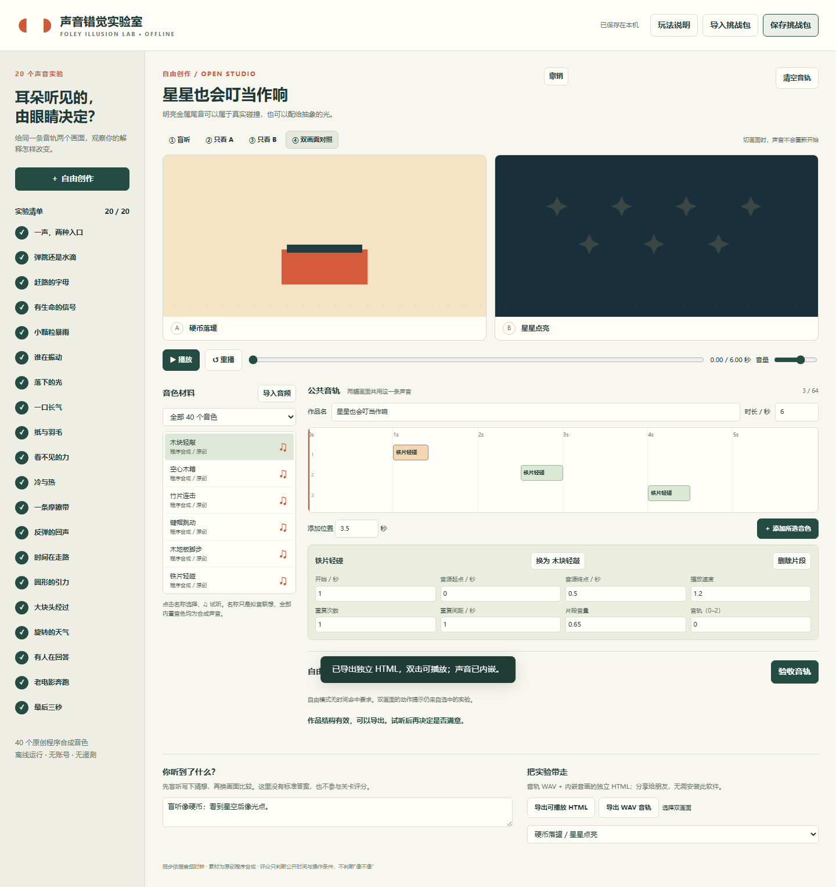

# 声音错觉实验室

同一条声音，给它两种画面。它可能是硬币落罐，也可能是星星点亮。

这是一个离线的拟音创作与小型解谜应用：20 组原创双画面实验、40 个原创合成音色，先盲听，再看 A / B 两种解释，切换画面时声音保持连续。时间线允许切片、调整速度、重复、间距、音量和叠加；可以完成公开约束，也可以自由创作并导出作品。



## 直接运行

Windows 解压下载包，双击 **`启动实验室.cmd`**，或直接打开 `index.html`。无需安装 Node、Python、账户或服务器；所有资源来自同一文件夹。请使用当前版本 Chrome / Edge / Firefox 等支持 Web Audio 的浏览器。

如果浏览器策略限制本地文件，可使用已安装的 Node.js 22+：

```sh
npm start
```

浏览器打开 `http://127.0.0.1:4175`。服务器仅监听本机；设置 `PORT` 可换端口。

## 五分钟试玩

1. 在欢迎窗口点击“开始第一个实验”。
2. 左侧音色默认选中“木块轻敲”；可以点击 ♫ 试听。
3. 在 **1.5 秒、3.5 秒** 各添加一个片段，点击“验收音轨”。
4. 点击播放，依次切换“盲听”“只看 A”“只看 B”。同一个声音会被视觉赋予不同来源。
5. 点击时间线片段修改参数；换音色、切短一些或重复，比较主观感受。记下“你听到了什么”。
6. 选择自由创作，可改作品名、2–20 秒时长和双画面组合，导入自己的短音效，导出 HTML 或 WAV。

全部关卡从开始就开放。每关都有提示和可修改的示例音轨，不需要麦克风或外部素材。示例按钮和清空操作可以撤销。

`examples/stars.html` 是应用实际导出的独立作品，可直接打开体验。`examples/stars.foley.json` 可通过“导入挑战包”载入后继续编辑。

## 完整功能

- 20 组实验，涵盖木门 / 巨书、橡胶球 / 水滴、打字 / 火车、心跳 / 灯塔、硬币 / 星星等 40 个原创 Canvas 画面。
- 8 类、40 个程序合成音色；全部离线生成，不假称真实现场采样。
- 盲听、只看 A、只看 B、双画面对照；播放、暂停、拖动进度、重播和主音量。
- 3 条可叠加音轨，最多 64 个片段；每片段可裁剪、0.5–2 倍速、1–8 次重复、0.15–4 秒间距、独立音量；5–10 ms 边缘淡化。
- 确定性公开验收：事件时间窗口、允许音色类别、最低音量与长度，以及个别关卡的重复 / 速度 / 切片条件。允许同类别多种音色及合理时间误差；不使用 AI 主观判断。
- 自由模式没有得分门槛；每个实验保留独立本机存档、笔记与完成记录，支持撤销。
- 每个作品最多导入 4 个短音效，单文件不超过 12 MB / 10 秒。解码格式取决于浏览器；WAV 最稳妥。混为单声道 24 kHz 后内嵌保存。
- JSON 挑战包导入 / 导出；格式版本、数据长度、音源引用、剪辑边界与数值范围检查，破损包不会覆盖当前作品。
- 导出 **24 kHz / 16-bit 单声道 WAV**，以及声音内嵌、可离线独立打开、保留盲听 / A / B 切换的 **HTML 作品**。导出不是 MP4 视频；不需要网络服务器托管。

## 数据与限制

没有网络请求、账户、遥测、上传和第三方运行依赖。作品存于当前浏览器的 `localStorage`；文件移动、换浏览器或清理浏览器数据后，存档可能不再可见。重要作品请另存挑战包。达到浏览器存储配额时，界面会提示保存挑战包，不会声称已经成功保存。

音画依据同一个音频时钟，动画刷新约 30 fps。后台标签页可能被浏览器暂停动画渲染；返回后按音频时间重新对齐。试听音色会暂停当前音轨，避免多音色试听无限叠加。作品尾部之外的声音会被截断，导出的长度严格等于作品时长。

双画面均为简洁几何动画，声音是合成拟音。关卡通过仅表示公开的编辑条件满足；“是否像”“是否造成错觉”“是否有趣”是主观体验。本仓库不把自动化通过当成真人趣味验证。具体已测与未测内容见 [TEST_REPORT.md](TEST_REPORT.md)。

当前版本不包含麦克风录音、视频编码导出、任意自定义视频导入、云同步或多人协作。用户音色只能用于创作，不自动算入内置音色类别的关卡条件。

## 开发与测试

仅运行应用不需要安装依赖。开发环境推荐 Node.js 22+。

```sh
npm ci
npm test
npx playwright install chromium
npm run test:ui
```

`npm test` 使用 Node 内置测试器，检查 20 关示例、素材数据、时间判定、重复 / 切片 / 速度规则、混音峰值、WAV 和损坏输入。UI 测试使用 Playwright 真实浏览器从 `file://` 打开应用，手工步骤完成教学、所有关卡、自由创作、音频导入、跨关切换、存档、撤销和独立 HTML 导出重开，并输出 `test-results/` 截图和样例文件。

GitHub Actions 会在每次 push / PR 运行核心与 UI 测试。`server.cjs` 仅用 Node 标准库，使用固定允许列表提供静态文件。

目录结构：`core.js` 为可测试领域逻辑，`scenes.js` 为原创场景渲染，`app.js` 为交互与本地持久化，`tests/` 为回归与浏览器验收。

## 开源许可

源代码：MIT，见 [LICENSE](LICENSE)。内置生成音频与原创动画美术：CC0-1.0，见 [ASSET-LICENSE.md](ASSET-LICENSE.md)。用户导入素材的权利不随项目许可改变。
